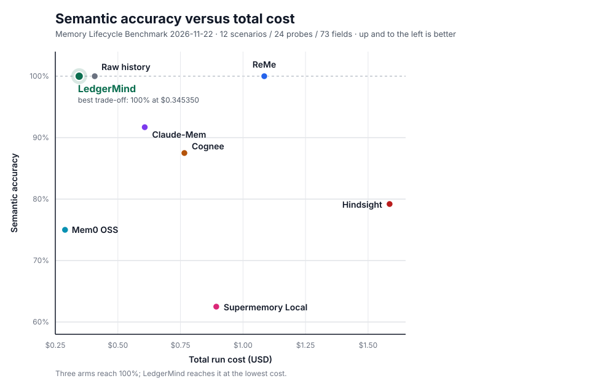
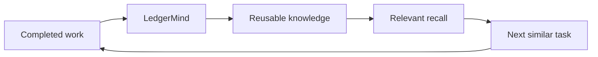

<p align="center">
  
  
</p>

<h1 align="center">LedgerMind</h1>

<p align="center">
  <strong>Your agent solved it once. It should not have to solve it from scratch again.</strong>
</p>

<p align="center">
  
  
  
  
</p>

<p align="center">
  <a href="#installation">Get started</a> ·
  <a href="#memory-lifecycle-measured-end-to-end">See the results</a> ·
  <a href="#your-knowledge-stays-local-by-design">Security</a> ·
  <a href="BENCHMARK.md">Benchmark</a> ·
  <a href="mailto:s.zotov@ledgermind.org">Talk to us</a>
</p>

## Agents should not have to relearn the same work

Your agent investigates a problem, tries an approach, fixes a mistake, and
eventually gets the job done. The next time a similar task appears, replaying
that entire journey is expensive and unnecessary.

LedgerMind turns completed workflows into compact, reusable knowledge. The
next agent receives the relevant procedure, constraints, and current decisions
without dragging the whole transcript back into its context window.

It is memory built for the next action—not a transcript archive and not a pile
of extracted notes.

LedgerMind is for anyone who wants an agent to remember what it has learned:
individual agent users, developers building local assistants, platform teams
adding memory to their products, and enterprises that need a controlled local
knowledge layer.

[See the benchmark](BENCHMARK.md) · [Follow releases](https://github.com/sl4m3/ledgermind/releases) · [Contact LedgerMind](mailto:s.zotov@ledgermind.org)

> **Current stable release:** `5.0.5` for supported Linux hosts.

## Memory lifecycle, measured end to end

The Memory Lifecycle Benchmark evaluates the full memory loop on real project
history across **12 scenarios** in four families—**E** (execution),
**I** (identity), **K** (knowledge evolution), and **R** (delivery)—totalling
**24 probes** and **73 checked fields** across **eight configurations** on the
same frozen corpus. Answers come from a fresh agent seeing only each arm's
retrieval and are scored by a **completed manual semantic review**, not an LLM
judge.

| Configuration | Version | Semantic, 24 probes / 73 fields | Agent input tokens | Agent cost (24 probes) | Total cost |
|---|---:|---:|---:|---:|---:|
| **LedgerMind** | 5.0.0 | **24/24, 73/73** | **269,844** | **$0.023185** | **$0.345350** |
| Raw history | — | 24/24, 73/73 | 14,531,917 | $0.407496 | $0.407496 |
| ReMe | 0.4.2.3 | 24/24, 73/73 | 366,693 | $0.023676 | $1.085034 |
| Claude-Mem | 16.0.4 | 22/24, 68/73 | 514,426 | $0.032235 | $0.607301 |
| Cognee | 1.6.10 | 21/24, 68/73 | 79,039 | $0.012222 | $0.765784 |
| Hindsight | 1.2.3 | 19/24, 66/73 | 500,616 | $0.033248 | $1.585927 |
| Mem0 OSS | 2.2.1 | 18/24, 60/73 | 172,064 | $0.019947 | $0.288878 |
| Supermemory Local | 0.0.9 | 15/24, 57/73 | 162,023 | $0.024472 | $0.893317 |



LedgerMind reached **24/24 probes and 73/73 fields** for **$0.345350 total**
(**$0.023185** on the 24 agent probes after one-time memory formation across 323
rounds):

- **Versus Raw history:** Raw history also reaches 24/24, but only by feeding
  the agent **14,531,917 input tokens (53.9× LedgerMind)** and spending
  **$0.407496 on the 24 probes (17.6× LedgerMind's query cost)** while replaying
  the full private transcript on every call. LedgerMind keeps a compact store of
  1,343 active knowledge values across 195 memory objects.
- **Versus ReMe:** ReMe reaches 24/24 at **$1.085034 (3.14× LedgerMind's total
  cost)** and depends on two accepted borderlines (`blocked` in
  `E2-P1.test_status` and listing five scales instead of `5` in `R2-P2`; a
  stricter reading puts ReMe at **22/24, 71/73**).

> **Reproducibility & pins:** Frozen corpus
> `sha256:1fd4d52163294f166fd481569bb6ab3f5654852ad0e3bdace72f74ce6158934f`
> and run config
> `sha256:645e9b85c1c175c3a16fe45439d2333b55433bf62b0ff22416e8375b51a8cf42`;
> model `meta/muse-ember` (agent reasoning `low`, memory reasoning `minimal`,
> route `google-vertex/global`); local 2048d `nemotron-3-embed-1b-bf16`
> embeddings (Claude-Mem used its built-in 384d ONNX model; Supermemory used a
> 2000d Matryoshka slice).

[Read the full benchmark report](BENCHMARK.md) or inspect the
[sanitized per-probe evidence](benchmarks/memory-lifecycle-2026-11-22/README.md).

### The 30-second version

| 1. The agent works | 2. LedgerMind learns | 3. The next task starts ahead |
|---|---|---|
| The workflow includes useful steps, investigation, corrections, and noise. | LedgerMind keeps reusable procedures, constraints, and current decisions. | The agent receives a focused memory instead of replaying the old transcript. |

**Same result, less repeated investigation, less context.** That is the whole
product promise—and the benchmark measures it at the next task, not by grading
how impressive the stored notes sound.

### Install in one command

LedgerMind `5.0.5` is available for **Linux x86_64**. On a desktop session the
one-command installer launches a local setup page in your browser (`127.0.0.1`
with a one-time token), detects supported agents, verifies provider schemas and
the signed release, and connects the integrations you select. Over SSH or on a
headless machine—or when `--cli` is passed—it automatically falls back to the
interactive terminal wizard:

```bash
curl -fsSL https://github.com/sl4m3/ledgermind/releases/latest/download/install.sh | sh
```

To force the terminal wizard directly:

```bash
curl -fsSL https://github.com/sl4m3/ledgermind/releases/latest/download/install.sh | sh -s -- --cli
```

[Read the complete installation guide](#installation) before managed or
non-interactive deployment.

### Pick the path that sounds like you

| You are… | Start here |
|---|---|
| Using an agent and tired of repeating yourself | [Install LedgerMind 5.0.5](https://github.com/sl4m3/ledgermind/releases/latest), then connect your agent |
| Building an agent, IDE, or local assistant | Explore [`integrations/`](integrations) and [`local/`](local) |
| Running an AI platform or enterprise deployment | [Contact LedgerMind](mailto:s.zotov@ledgermind.org) for evaluation, deployment, and licensing |
| Comparing memory systems | Jump to the [benchmark results](#memory-lifecycle-measured-end-to-end) and [full methodology](BENCHMARK.md) |

## Where LedgerMind is available

LedgerMind ships as two clearly separated products: **LedgerMind Local** (the
self-hosted runtime next to your agent using models you configure) and
**LedgerMind Cloud** (managed workspaces on [ledgermind.org](https://ledgermind.org)
via the lightweight Cloud Connector).

| Agent | Integration | Activation note |
|---|---:|---|
| Hermes | Available | Plugin activates after connection |
| Codex (CLI) | Available | Review and trust the hooks with `/hooks` |
| Codex (Desktop) | Available | Uses the same trusted Codex hooks |
| Claude Code CLI | Available | Restart an already running session |
| OpenCode | Available | Restart an already running session |
| OpenClaw | Available | Restart an already running session |

The published `5.0.5` package supports **Linux x86_64** (Linux aarch64 is part
of the platform design, not included in this release). Legacy `3.x` and `4.x`
release tags should not be used as installation packages for this README.

## Installation

LedgerMind installs without root access into the current user's XDG
directories. Docker is not required and is not a supported secure deployment
path for `5.0.5`. The installer verifies the signed manifest, platform bundle,
Core binary, and applicable runtime artifacts before switching the active
version.

### Requirements

- Linux x86_64 with glibc 2.31 or newer;
- `bubblewrap` (`bwrap`) available to the current user (Core startup fails
  closed if the isolation probe does not pass);
- an installed supported agent;
- a generation provider and model with strict JSON Schema structured outputs;
- an OpenAI-compatible embedding API or the supported local embedding runtime.

### Choose your setup

| Setup | Best for | What you do |
|---|---|---|
| Interactive | Individual users and first installations | Run one command and answer the wizard |
| Agent-assisted | Coding agents and automated setup | Let the agent collect choices, write a private config, and run one command |
| Managed | Teams and enterprise environments | Use the same non-interactive installer with controlled profiles and secrets |

### 1. Prepare the deployment choices

Before installation, decide:

1. which supported agent or agents should use the memory;
2. the language in which LedgerMind should form semantic knowledge (English,
   Russian, Spanish, Portuguese, French, German, or Ukrainian);
3. the OpenAI-compatible generation endpoint and model;
4. whether embeddings should use an API or the signed local CPU runtime;
5. whether retrieval reranking is disabled, provided by an API, or performed
   by the separately installed local CPU runtime;
6. how provider credentials will be supplied (`token_env`, `token_stdin`, or an
   existing `secret_ref`; never place a plaintext token in the config file).

### 2. Run the interactive installer

```bash
curl -fsSL https://github.com/sl4m3/ledgermind/releases/latest/download/install.sh | sh
```

By default on desktop Linux (`DISPLAY` or `WAYLAND_DISPLAY` set), this opens
the local setup wizard on `http://127.0.0.1:<port>/?token=...` in your browser
(pass `--no-browser` to print the URL without opening a tab, `--web` to force
the browser UI, or `--cli` to run the guided terminal wizard instead).

The wizard detects the Linux platform and installed agents, asks for your
selected agents and model/runtime settings, verifies the signed platform bundle,
installs without root access, connects the selected agents, and runs
installation checks.

### 3. Or let an agent install it non-interactively

Collect the deployment choices above, write a private config file with
owner-only permissions, and run one command:

```bash
chmod 600 /secure/ledgermind-install.json
curl -fsSL https://github.com/sl4m3/ledgermind/releases/latest/download/install.sh \
  | sh -s -- install --non-interactive \
      --config /secure/ledgermind-install.json --json
```

The installer verifies strict JSON Schema support before completing. For
reliable production behavior, use a generation model with **120B parameters or
more** and an endpoint supporting **strict JSON Schema structured outputs**
(the Memory Lifecycle Benchmark used `meta/muse-ember` and release integration
checks used `deepseek/deepseek-v4-flash-0731`).

> **For agents:** ask the user for missing deployment choices. Do not invent a
> provider, model, endpoint, embedding dimension, route, or secret source.

### 4. Updating and rolling back

Once LedgerMind is installed, check for and apply signed releases directly from
the CLI (configuration, credentials, agent integrations, and memory databases
are preserved automatically):

```bash
ledgermind update --check       # Check latest signed release & patch size
ledgermind update               # Update to latest release (layered patch when compatible)
ledgermind update --version 5.0.5
ledgermind rollback             # Restore the previous retained release cleanly
```

When a release shares the same verified Python and embedding runtime layers as
the active installation, `ledgermind update` downloads only the compact **layered
patch archive** (`ledgermind-patch-linux-x86_64.tar.zst`, tens of MiB instead of
the full ~670 MiB bundle), reuses the immutable runtime layers via hardlinks,
re-verifies every file hash and Ed25519 signature in `bundle-manifest.json`,
prunes older releases (keeping `--keep-releases 2` by default for rollback), and
automatically rolls back if post-update `doctor` checks fail.

- Override the release channel mirror via `LEDGERMIND_RELEASE_BASE_URL`.
- `ledgermind status` displays cached update availability when known (disable
  via `LEDGERMIND_NO_UPDATE_CHECK=1`).
- Run `ledgermind --help` for the full CLI command reference (`status`, `doctor`,
  `configure`, `repair`, `integrations`, `runtime`, `export-config`,
  `import-config`).

<details>
<summary><strong>Show a complete API-based configuration and reranker reference</strong></summary>

<br>

```json
{
  "schema_version": 2,
  "semantic_language": "en",
  "memory_mode": "shared",
  "integrations": [
    {"id": "codex", "enabled": true},
    {"id": "claude-code", "enabled": true}
  ],
  "generation": {
    "endpoint": "https://openrouter.ai/api/v1",
    "provider_profile": "openrouter",
    "route": "provider-a/fp8",
    "fallback_routes": ["provider-b/fp8"],
    "model": "deepseek/deepseek-v4-flash-0731",
    "object_resolution_model": "deepseek/deepseek-v4-flash-0731",
    "token_env": "LEDGERMIND_GENERATION_TOKEN"
  },
  "resolution_decision": {
    "backend": "jev"
  },
  "embedding": {
    "mode": "api",
    "api": {
      "endpoint": "https://openrouter.ai/api/v1",
      "model": "nvidia/nemotron-3.5-embed-1b:free",
      "dimensions": 2048,
      "token_env": "LEDGERMIND_EMBEDDING_TOKEN"
    }
  },
  "reranker": {
    "mode": "disabled"
  }
}
```

- Remove `fallback_routes` to pin OpenRouter to the primary route only; the
  provider profile disables reasoning for LedgerMind's internal semantic calls
  without affecting your agent's own reasoning setting.
- **Reranker modes:** `disabled` (deterministic Core ranking), `api`
  (Cohere-compatible or NVIDIA NIM endpoint), or `local` (separately downloaded
  signed Qwen3-Reranker-0.6B CPU runtime from the
  [5.0.0 release](https://github.com/sl4m3/ledgermind/releases/tag/v5.0.0),
  verified with `install-reranker-runtime.py`). Failures fail open to Core
  order; knowledge items are never cut mid-item.
- **Memory mode:** `"shared"` shares one knowledge space across connected
  agents; `"per_agent"` isolates each agent via `memory_space_id`.
- **Residency modes:** `Session` (recommended, crash-safe TTL), `Idle timeout`,
  or `Always on`.

</details>

<details>
<summary><strong>Manage integrations, verify, update, or uninstall LedgerMind</strong></summary>

<br>

**Connect additional agents** (restart an already running session; Codex CLI
requires trusting new hooks via `/hooks`):

```bash
ledgermind integrations discover --json
ledgermind integrations connect hermes --json
ledgermind integrations connect codex --json
ledgermind integrations connect claude-code --json
ledgermind integrations connect opencode --json
ledgermind integrations connect openclaw --json
```

**Verify installation** (`installed` → `connected` → `enabled` → `active`):

```bash
ledgermind status
ledgermind doctor
ledgermind integrations status
ledgermind runtime status
```

**Update or roll back LedgerMind** (preserves configuration, memory, secrets,
and integrations):

```bash
ledgermind update --check
ledgermind update
ledgermind rollback
ledgermind doctor
```

*Or update via bootstrap script from an older pre-`5.0.3` installation:*

```bash
LEDGERMIND_RELEASE_BASE_URL=https://github.com/sl4m3/ledgermind/releases/latest/download \
  ledgermind install --existing-mode update
```

**Remove or purge LedgerMind** (stop active agent sessions first; normal
uninstall preserves memory, config, and secrets and writes a backup):

```bash
ledgermind uninstall --dry-run --json
ledgermind uninstall --json
ledgermind integrations disconnect hermes --json
ledgermind uninstall --purge-data --purge-config --yes --json
```

`--purge-data` removes the memory database, models, and integration data;
`--purge-config` removes installer config, secret references, and Local runtime
data. Both require `--yes` and are irreversible. Run `ledgermind status --json`
to inspect exact XDG installation paths.

</details>

## Your knowledge stays local by design

LedgerMind Core is proprietary, but it is not a cloud service and it has no
hidden network path. Core runs as a local, network-isolated process and owns a
private local knowledge database.

- Core contains no HTTP, TLS, DNS, or cloud client.
- Core never receives API keys, provider credentials, model endpoints, or
  remote-service configuration.
- Core communicates only with the local LedgerMind runtime through a versioned
  process boundary.
- All external communication is handled outside Core by publicly inspectable
  components: [`integrations/`](integrations) and [`local/`](local).
- The operator chooses every model and delivery endpoint. With local generation
  and embedding models, the complete memory workflow can remain on the user's
  machine.

If an operator configures a remote model provider, the necessary model payload
leaves the machine only through Local to that explicit endpoint—never from Core
itself.

## Memory that compounds



A useful memory system must do more than find a similar sentence. LedgerMind is
designed to preserve reusable knowledge while leaving exploratory noise behind,
recognize when new evidence refers to something already known, revise knowledge
when an authoritative rule changes, retain source evidence and change history,
and return a focused working context instead of an ever-growing transcript.

## What the agent receives

LedgerMind does not ask the next agent to reread the transcript that created a
piece of knowledge. It returns a small working context containing the current
procedure and the conditions that matter to the new task.

For example, a rollout history may contain investigation, a failed legacy
backup attempt, a corrected immutable snapshot step, CAB approval, execution,
and validation. On the next rollout, the useful result is closer to:

```text
Production rollout

- Create an immutable snapshot before making the change.
- CAB approval remains mandatory.
- Apply the configuration, validate health, and use the snapshot for rollback.
- Do not use the superseded legacy backup step.
```

## Data flow and control

| Data | Where it is handled | Can it leave the machine? |
|---|---|---|
| Completed messages and tool activity | Captured by Integrations and delivered to the configured runtime | Only through the delivery endpoint selected by the operator |
| Raw workflow payloads | Stored by Local for durable processing and bounded retention (30 days default) | Only when Local sends the necessary payload to a configured remote model |
| Provider credentials | Stored by reference in Local's secret boundary | Used only to authenticate to the operator-selected provider; never passed to Core |
| Durable knowledge | Owned by Core in its private local database | Core has no network client and cannot transmit it |
| Recalled working context | Returned locally to the requesting integration or agent | It may subsequently leave through that caller if the operator uses a remote agent |

## What LedgerMind is not

LedgerMind is not long-term storage for every message an agent has seen, a vector
database presented as a complete memory system, an autonomous source of truth,
or a benchmark optimized to match a hand-written answer key. Its value is
measured downstream: whether the next task finishes correctly with less repeated
investigation and less context.

## Repository layout, release channels, and license

This repository is the public half of LedgerMind (`ledgermind-platform` holds
the proprietary Core, Cloud backend, inference boundary, and lab).

| Path / Channel | Contents / Entry point | License |
|---|---|---|
| [`protocol/`](protocol) | RawRound/ContextView contracts, JSON schemas, conformance fixtures | Apache-2.0 |
| [`integrations/`](integrations) | Agent adapters (Hermes, Codex, Claude Code, OpenCode, OpenClaw) and capture runtime | Apache-2.0 |
| [`local/`](local) | LedgerMind Local `5.x` CLI, service, installer, tests ([`local/LICENSE`](local/LICENSE)) | BUSL-1.1 |
| [`cloud/`](cloud) | Cloud Connector channel (`https://ledgermind.org/install-cloud.sh`, `cloud-v*`) | Apache-2.0 |
| [`skills/`](skills), [`benchmarks/`](benchmarks) | Agent discovery skill and published `2026-11-22` benchmark artifacts | Apache-2.0 |
| **Signed releases** | [GitHub Releases](https://github.com/sl4m3/ledgermind/releases) (`install.sh`, `5.x` packages, `cloud-v*`) | Per-package terms |

Local's Business Source License 1.1 permits internal-tool and non-commercial
deployments under its Additional Use Grant and transitions to GPLv3-or-later on
the stated Change Date; production use outside that grant requires a commercial
license. Proprietary pieces (Core, Cloud backend, inference) are distributed
only as signed binaries or official release archives under their own license
files.
